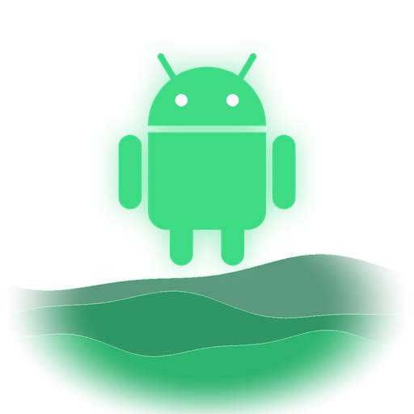
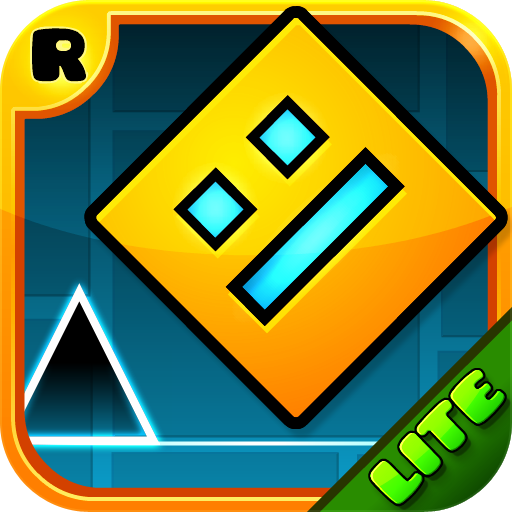
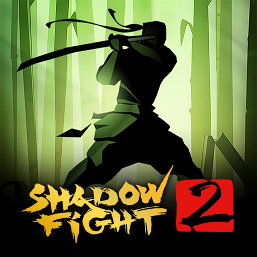
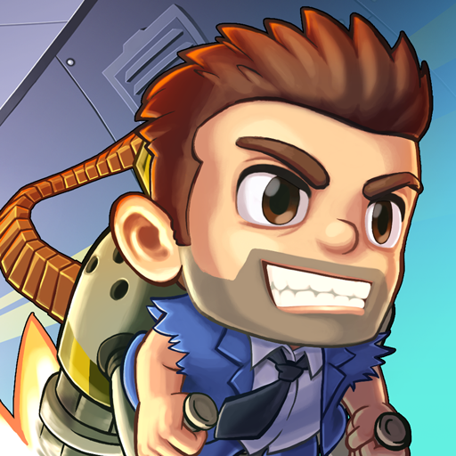
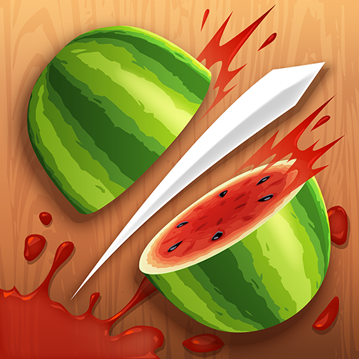

  

<h1 align="center">Hydroid</h1>

  <b>Android games on PS5.</b> 

  
  

---

## About

Each game in the collection is a separate PS5 app with its own name, icon and background.
There is no launcher and no menu in between: the app opens straight into the game.

Each app is made and tested for its one game, so an update for one game never breaks another.

## Games

| | Game | App | Version tested | State |
|:---:|---|---|---|---|
|  | **Subway Surfers** | PPSA26370 | 3.70.3 | Playable |
|  | **Geometry Dash Lite** | PPSA26371 | 2.2.148 | Playable |
|  | **Crossy Road** | PPSA26372 | 7.14.0 | Playable (stutters in menus) |
|  | **Sonic Dash** | PPSA26375 | 10.5.1 | Playable (stutters a little) |
|  | **Sonic Boom** | PPSA26376 | 3.26.0 | Playable |
|  | **Shadow Fight 2** | PPSA26377 | 2.46.0 | Playable |
|  | **Jetpack Joyride** | PPSA26378 | 1.104.1 | Playable |
|  | **Temple Run 2** | PPSA26379 | 1.137.0 | Playable |
|  | **Fruit Ninja** | PPSA26380 | 2.8.9 | Playable |

Every game plays with the DualSense: its own controller support where it has one, otherwise
the buttons are set up for its touch controls.

## Installing

1. Download the game's app from [Releases](../../releases) and unzip it.
2. Copy its folder to the PS5 homebrew folder:
   `/data/homebrew/`
3. Put a copy of the game (`.apk`, `.xapk`, `.apks` or `.apkm`) in the app's `game` folder:
   `/data/homebrew/<app>/game`
4. Start the game.

The apps don't include the games. use the tested versions for best compatibility.

## Built on

[dynarmic](https://github.com/lioncash/dynarmic) (ARM JIT) ·
[FalsoJNI](https://github.com/v-atamanenko/FalsoJNI) (JNI) ·
Mesa (OpenGL, RADV Vulkan) ·
[astc-encoder](https://github.com/ARM-software/astc-encoder) ·
[stb](https://github.com/nothings/stb).

## Disclaimer

Hydroid runs games you own on hardware you own. It contains no game files and no Sony or
Google code. Not affiliated with Sony, Google or any game publisher.

## License

GPL-3.0. See [LICENSE](LICENSE).

The Android robot is reproduced or modified from work created and shared by Google and used
according to terms described in the Creative Commons 3.0 Attribution License.
